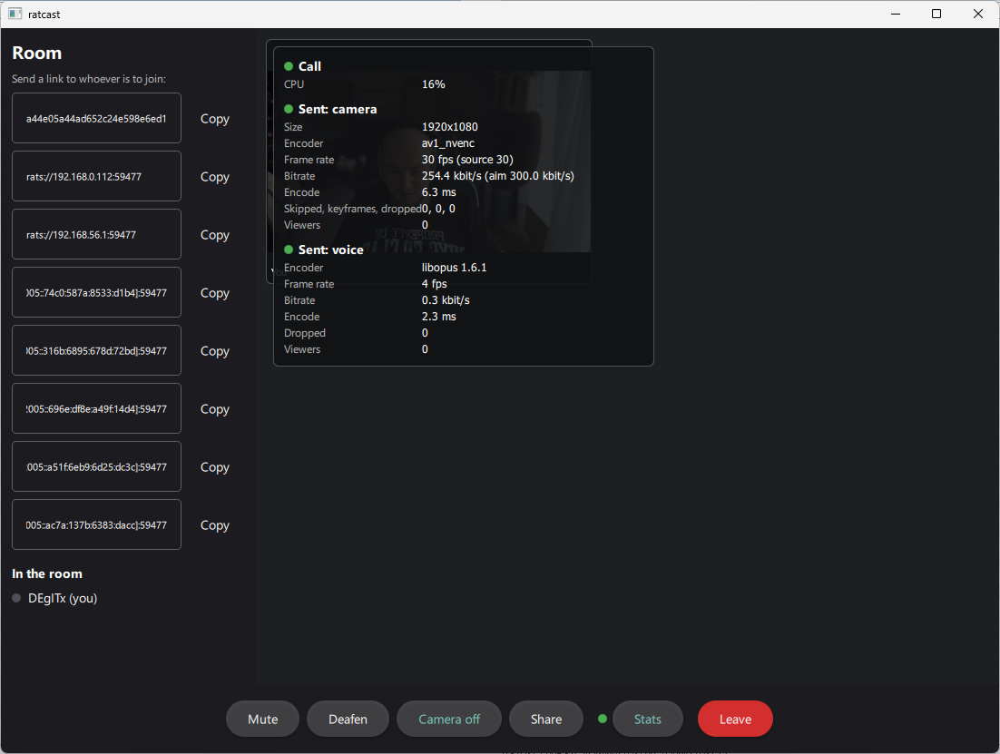
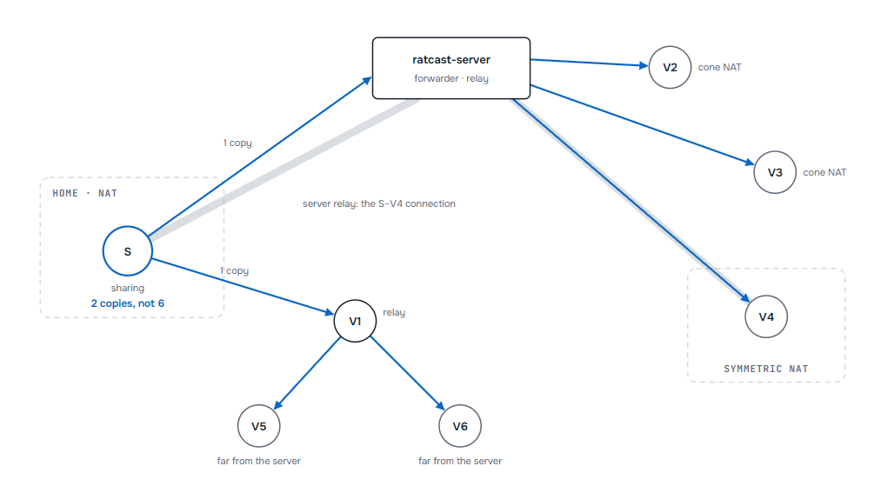

# ratcast

<p align="center">
  <a href="https://github.com/librats/ratcast">
    <picture>
      <source media="(prefers-color-scheme: dark)" srcset="docs/logo-dark.png">
      
    </picture>
  </a>
</p>

<p align="center">
  <a href="https://github.com/librats/ratcast/actions/workflows/ci.yml"></a>
  <a href="https://github.com/librats/ratcast/releases"></a>
  <a href="LICENSE"></a>
  <a href="https://isocpp.org/"></a>
</p>

<p align="center"><b>Peer-to-peer calls and screen sharing for watching things together.</b><br><a href="https://ratcast.app">ratcast.app</a></p>

One person shares a movie, a game or a desktop, and the others watch it live while everyone talks.
There is no account to create and no service in the middle. You make a room, send the link, and
the picture goes straight from the sharer to each viewer, encrypted end to end.

ratcast is built on [librats](https://github.com/librats/librats). It comes in two parts:

- **ratcast**: the desktop app for Windows and Linux, with macOS (Apple Silicon) in preview,
  and Android in preview too: watching a share, talking, a camera, and sharing the phone's
  screen with its sound.
- **libratcast**: the media transport underneath it. You can use it on its own, much like SRT
  or librist.

## Features

- **Rooms by link.** Make a room, copy its `rats://` link and send it to whoever should join.
  Peers find each other through the DHT. A server is optional.
- **Share a screen or a window with its sound.** Viewers hear what your applications play, but
  never the call's own voices.
- **Voice that is easy to listen to.** Echo cancellation, noise suppression and automatic gain
  (WebRTC AudioProcessing) are built in. You can mute or deafen yourself and see who is speaking.
- **Camera.** Each side can show itself next to the share. Without a share, everyone is a tile
  in a grid, and whoever speaks is ringed. In a room of more than seven, you see the cameras of
  the last six to speak.
- **Text chat.** Write to the room next to the call. Links open in the browser, and whoever
  joins later sees the last hundred messages.
- **Settings.** Pick the microphone, speaker and camera if the system's defaults are not the
  ones, even in the middle of a call. The window can go to the tray when minimized or closed,
  and the room goes on.
- **Hardware encoding.** AV1, HEVC and H.264 run on NVENC, AMF or Quick Sync when a GPU has
  them, and HEVC and H.264 on VideoToolbox on a Mac. Otherwise SVT-AV1, libaom or OpenH264 encode
  on the CPU. On Windows and macOS the screen goes to the encoder without leaving the GPU.
- **Low latency on real networks.** Rate control follows the path, and FEC and retransmission
  repair losses within each frame's deadline. On one host a picture takes about 18 ms from
  capture to the screen. The numbers for lossy and distant paths are in
  [docs/bench.md](docs/bench.md).
- **Encrypted end to end.** Connections use the Noise protocol, and every frame is also sealed
  with SFrame. A server that forwards a share can't read it.
- **Gets through NATs.** It tries port mapping and hole punching first, then falls back to a
  relay through a `ratcast-server` when nothing else works.
- **Updates itself.** The app installs new releases from GitHub, but never while a call is on.

## Download

Get the latest build from [Releases](https://github.com/librats/ratcast/releases).

| Platform | Package | Notes |
|---|---|---|
| Windows 10/11 x64 | `ratcast-<version>-windows-x64.zip` | Unzip and run `ratcast.exe` |
| Linux x86_64 | `ratcast-<version>-linux-x86_64.AppImage` | glibc 2.39+ and PipeWire 1.0+ (Ubuntu 24.04, Debian 13, Fedora 40 or newer) |
| macOS 14+ Apple Silicon (preview) | `ratcast-<version>-macos-arm64.dmg` | Drag `ratcast` into Applications. It is not notarized: open it the first time with right-click → **Open** |
| Android 10+ arm64 (preview) | `ratcast-<version>-android-arm64.apk` | Open it on the phone and allow installing from that app. Watch, talk, show a camera and share the screen; a newer APK installs over it. A `rats://` link opens the app |

## Using it

1. **Make a room** and send the link it shows to your friends.
2. They paste the link and press **Join**. A link given on the command line works too:
   `ratcast rats://…`.
3. Press **Share**, choose a screen or a window, and decide whether to share its sound.
   The others press **Watch**.

While watching, press **F** or double-click the picture to go full screen, and **Esc** to leave
it. **Ctrl+I** shows how the call is going: bitrate, latency and losses.

<p align="center">
  
</p>

The app keeps its identity and log (`ratcast.log`) in `%LOCALAPPDATA%\ratcast` on Windows, in
`~/.local/share/ratcast` on Linux and in `~/Library/Application Support/ratcast` on macOS. To find
them, use **Open log folder**.

## Network topology

Every room starts as a mesh. Each member connects to each, and the sharer sends its own copy of
the picture to every viewer. When the sharer's uplink can't carry all the copies, the share is
rearranged one viewer at a time:

- **Through a server.** A `ratcast-server` forwards the share like an SFU, so the sharer uploads
  one copy for all the viewers the server takes. Viewers whose connection the server relays anyway,
  such as those behind symmetric NATs, always get the share this way.
- **Through another viewer.** A viewer with spare uplink passes the frames on as they came,
  without re-encoding. This is used when there is no server, or when a frame through the server
  would arrive too late.
- **Directly**, as before, for the viewers the uplink still has room for.

Sound always comes straight from the sharer. Keyframe requests and SFrame keys also go directly
between the sharer and each viewer. Frames stay sealed on every hop, and a server is never given
a key.

<p align="center">
  
</p>

In this room of seven, the sharer uploads two copies instead of six.

## Running a server

Calls usually connect directly. A `ratcast-server` on a public host helps the rest. Rooms behind
strict NATs can meet there, and it relays a connection when no direct path can be punched. It
can also forward a share, so the sharer uploads one copy no matter how many people watch. It
can't read anything it carries, and calls work fine without one.

The server needs only librats and libratcast, with no media libraries and no Qt:

```bash
git clone --recursive https://github.com/librats/ratcast.git
cd ratcast
cmake -S . -B build -DCMAKE_BUILD_TYPE=Release -DRATCAST_SERVER_ONLY=ON -DRATCAST_BUILD_TESTS=OFF
cmake --build build --parallel 2
sudo cmake --install build                  # /usr/local/bin/ratcast-server
sudo cp server/ratcast-server.service /etc/systemd/system/
sudo systemctl enable --now ratcast-server
journalctl -u ratcast-server -f             # its id, then what it does each minute
```

The server listens on port **7700, both UDP and TCP** (change it with `--port`), so open both in
the firewall. Enter it in the app's *Settings*, under *Network* (`HOST` or `HOST:PORT`), or pass
`--server HOST` to the tools. A build can name a default server with
`-DRATCAST_DEFAULT_SERVER=HOST`. `ratcast-server --help` lists the limits you can set.

With `--announce` the server is found by the other servers that announce themselves in the
DHT, and finds them. Each tells the calls it helps about the others, and a call remembers them
in its data folder. The members of a room all pick the same two of the servers they know, by a
hash of the room's link, so a room needs no server named to meet at one. A room that wants its
own names it in its link: `rats://PEER-ID?via=HOST`, which the app adds when its settings name
a server. A build starts from the servers it is given with `-DRATCAST_SERVERS=HOST;…`
(`degitx.com` by default). The DHT runs on a UDP port of its own, so let outgoing UDP and its
answers through.

## Building

```bash
git clone --recursive https://github.com/librats/ratcast.git
cd ratcast
cmake --preset debug          # or: core (libraries only, no Qt), release, asan, tsan
cmake --build --preset debug
ctest --preset debug
```

If you already cloned without `--recursive`, run `git submodule update --init --recursive`.

**Requirements:** CMake 3.22+, Ninja and a C++20 compiler. The media libraries are optional:
FFmpeg, libopus, PipeWire (Linux) and `webrtc-audio-processing-1`, found through pkg-config.
Without one of them, the parts that need it are left out. The app also needs Qt 6.6+ with Qt Quick,
Qt Shader Tools and QtGui's private headers. On Debian and Ubuntu, install
`qt6-declarative-dev qt6-shadertools-dev qt6-base-private-dev`. With the Qt installer, add the
Qt Shader Tools module. Without Qt the app is skipped and the libraries still build.

Programs are built into `build/<preset>/bin`.

<details>
<summary><b>Windows</b></summary>

You need Visual Studio 2022 (MSVC) and the Windows SDK. The media libraries come from
[vcpkg](https://vcpkg.io), and WebRTC's AudioProcessing comes from the overlay port in this
repository:

```powershell
vcpkg install ffmpeg[avcodec,avformat,swscale,nvcodec,amf,qsv,dav1d,svt-av1,aom,openh264] `
    opus pkgconf webrtc-audio-processing sdl3 --overlay-ports=cmake/vcpkg-ports --triplet x64-windows
```

These FFmpeg features cover every encoder the engine may pick. The GPU encoders (NVENC, AMF,
Quick Sync) get their runtimes from the drivers. Never add `gpl` or `version3`: the app is MIT
and ships FFmpeg under LGPL 2.1.

Then configure with vcpkg's toolchain and Qt's prefix, for example in a `CMakeUserPresets.json`:

```json
{
  "version": 6,
  "configurePresets": [{
    "name": "msvc", "generator": "Visual Studio 17 2022", "architecture": "x64",
    "binaryDir": "${sourceDir}/build/${presetName}",
    "toolchainFile": "C:/vcpkg/scripts/buildsystems/vcpkg.cmake",
    "cacheVariables": { "CMAKE_PREFIX_PATH": "C:/Qt/6.10.3/msvc2022_64" }
  }],
  "buildPresets": [{ "name": "msvc-debug", "configurePreset": "msvc", "configuration": "Debug" }],
  "testPresets": [{ "name": "msvc-debug", "configurePreset": "msvc", "configuration": "Debug" }]
}
```

The app captures screens through Windows.Graphics.Capture (Windows 10 1903+), sound through
WASAPI and cameras through Media Foundation. Sharing the applications' sound without the call's
own needs Windows 10 2004 or newer.

`cmake --install` lays out a folder that runs on a bare Windows. It holds the programs, their
DLLs, Qt and MSVC's runtime.

</details>

<details>
<summary><b>macOS</b></summary>

You need macOS 14 or newer and Xcode's command-line tools. FFmpeg, Opus and SDL3 come from
Homebrew. WebRTC's AudioProcessing isn't in Homebrew, so it comes from the overlay port in this
repository through [vcpkg](https://vcpkg.io):

```bash
brew install ffmpeg opus sdl3 pkgconf
vcpkg install webrtc-audio-processing --overlay-ports=cmake/vcpkg-ports --triplet arm64-osx \
    --x-install-root=$PWD/vcpkg-installed
export PKG_CONFIG_PATH=$PWD/vcpkg-installed/arm64-osx/lib/pkgconfig
cmake --preset debug -DCMAKE_PREFIX_PATH=~/Qt/6.10.3/macos
```

Homebrew's FFmpeg is fine for building, but it includes GPL encoders. The release bundles an
LGPL build from vcpkg instead (`ffmpeg[core,avcodec,avformat,swscale,dav1d,svt-av1,aom,openh264]`
with the `arm64-osx-dynamic-release` triplet in `cmake/vcpkg-triplets`).

The app is a bundle, `ratcast.app`. It captures screens and windows through ScreenCaptureKit and
the system's picker, sound through Core Audio and cameras through AVFoundation. H.264 and HEVC
are encoded on VideoToolbox. Sharing the applications' sound uses Core Audio's process taps,
which need macOS 14.2. macOS asks for permission to use the microphone, the camera and the
applications' sound the first time each is used. The command-line tools capture the main screen,
which needs the Screen Recording permission for the terminal they run in.

`cmake --install` puts Qt and the libraries the app links into the bundle (macdeployqt).

</details>

<details>
<summary><b>Releases</b></summary>

[`release.yml`](.github/workflows/release.yml) builds the Windows zip, the Linux AppImage,
the macOS DMG (with the same bundle zipped for the updater) and the Android APK on every push
to `main` and publishes them as a GitHub release for each `v*` tag. The APK is signed with the
key in the repository's secrets (`ANDROID_KEYSTORE`, the keystore in base64, with
`ANDROID_KEY_ALIAS`, `ANDROID_KEYSTORE_PASSWORD` and `ANDROID_KEY_PASSWORD`), so that each
release installs over the one before; without them, with a key made for the run. The Windows and Linux packages carry the
same FFmpeg encoders; on macOS the GPU's encoders are VideoToolbox's. The bundle is signed ad
hoc, not notarized. The version comes from `-DRATCAST_VERSION`, or else from the last
`v*` tag. Only the desktop's release builds update themselves (`-DRATCAST_UPDATES=ON`). They check GitHub
shortly after start and then every six hours, and verify each download against its SHA-256. The
AppImage is replaced at once. The Windows folder and the macOS bundle are replaced at the next
start, or at once with **Restart now**.

</details>

## libratcast

libratcast moves encoded frames between peers. It has no codecs and no capture, so it is useful
without the rest of ratcast, and the server links only this library.

- **Deadline-bound delivery.** Each frame either arrives in time or is dropped, so the stream
  never stalls behind an old one. Losses are repaired with FEC and retransmission.
- **Rate control** follows librats' path measurements. When one peer receives several streams,
  they share its path.
- **One-to-many.** One sender can feed many viewers, directly or through a server.
- **Every frame is encrypted with SFrame**, with a key for each sender.
- **Tools.** `ratcast-send` and `ratcast-recv` can carry an MPEG-TS feed in and out.
  `bench/netem.py` compares the transport with SRT and librist on emulated networks.

libratcast has a C API, [`ratcast/ratcast.h`](libratcast/include/ratcast/ratcast.h), built on
librats' own ([`rats.h`](external/librats/src/librats/bindings/rats.h)). librats creates the node
and connects it, and ratcast carries the media:

```c
rats_config_t config = {.protocol = RATCAST_PROTOCOL};  /* reaches ratcast-send */
rats_t node = rats_create(&config);
ratcast_t media;
ratcast_handlers_t handlers = {.user = app, .stream_announced = on_stream,
                               .frame_received = on_frame};
ratcast_attach(node, &handlers, NULL, &media);  /* before rats_start() */
rats_start(node);
rats_connect(node, "sender.example", 7700);

/* on_stream: subscribe to what the sender offers; a feed in order, 200 ms behind */
ratcast_subscribe(media, peer_id, stream->id, 200000);
```

A sender offers streams with `ratcast_add_stream()` and sends encoded frames with
`ratcast_send_frame()`. [`test_capi_c.c`](libratcast/tests/test_capi_c.c) is a complete program.

To try the transport on one machine, run `ratcast-send --source pattern --audio tone` and
`ratcast-recv rats://127.0.0.1:7700`.

## More

- [librats](https://github.com/librats/librats): the P2P layer underneath.
- [`website/`](website): the project's site, [ratcast.app](https://ratcast.app)

## License

[MIT](LICENSE). ratcast has no GPL dependencies.
